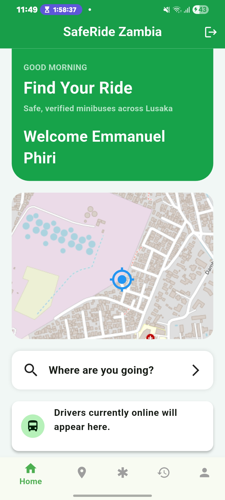
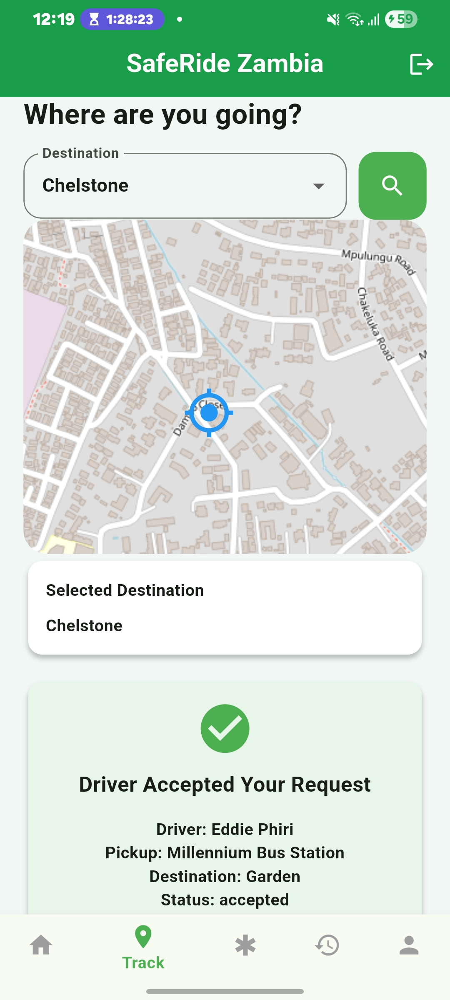
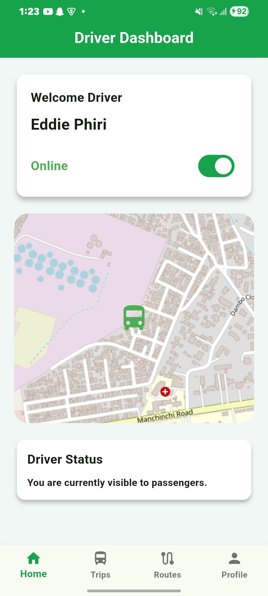
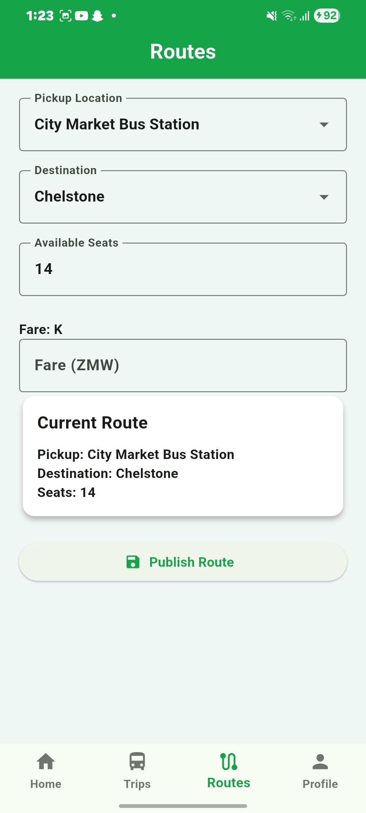
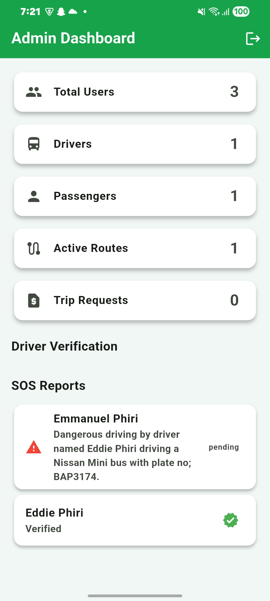

# SafeRide Zambia

SafeRide Zambia is a mobile application developed to improve safety, transparency, and accessibility in public transport in Zambia.

The application connects passengers and drivers through a role-based platform that supports route discovery, trip management, driver information, location-based functionality, seat requests, reviews, and emergency assistance.

SafeRide Zambia was developed as my final-year Computer Science project at ZCAS University.

## Problem Statement

Public transport users can face challenges such as limited access to reliable trip information, difficulty identifying drivers, uncertainty about available transport, and safety concerns while travelling.

SafeRide Zambia explores how a mobile application can provide passengers with better access to transport information while giving drivers tools for managing routes and passenger requests.

## Key Features

### Passenger

- User registration and authentication
- Passenger profile management
- Search and view available routes
- View driver and trip information
- Request seats on available trips
- View current and previous trip activity
- Map and location-based functionality
- Submit driver reviews
- Emergency assistance functionality

### Driver

- Driver registration and authentication
- Driver profile management
- Create and manage transport routes
- View passenger seat requests
- Accept passenger requests
- Manage available seat capacity
- View active and previous trips
- Map and location-based functionality
- View passenger feedback and ratings

### Admin

- View system statistics for users, drivers, passengers, and active routes
- Monitor SOS reports submitted by passengers
- View driver verification information
- Monitor route and trip activity

## Technologies Used

- **Flutter** - Mobile application framework
- **Dart** - Application programming language
- **Firebase Authentication** - User authentication
- **Cloud Firestore** - Application data storage
- **Firebase** - Backend services
- **flutter_map & OpenStreetMap** - Map and location functionality
- **Git & GitHub** - Version control and source-code management

## Application Architecture

The project separates major application responsibilities into areas such as:

- Authentication
- User profiles
- Passenger functionality
- Driver functionality
- Route and trip management
- Maps and location
- Firebase services
- Shared application themes and models

The application uses role-based navigation to provide different functionality to passengers and drivers.

## Project Structure

```text
lib/
|-- core/
|   `-- theme/
|-- model/
|-- services/
|-- view/
|   |-- auth/
|   |-- home/
|   |-- maps/
|   `-- profile/
|-- firebase_options.dart
`-- main.dart
```

## Screenshots

### Passenger Dashboard

The passenger dashboard provides access to ride discovery, location-based functionality, and other passenger services.



### Passenger Ride Request

Passengers can select a destination and view the status of their ride request after it has been accepted by a driver.



### Driver Dashboard

Drivers can manage their availability and view their current location through the driver dashboard.



### Route Management

Drivers can configure and publish routes by selecting pickup and destination locations and specifying available seats.



### Admin Dashboard

The administrative dashboard provides an overview of system activity, driver verification information, and submitted SOS reports.



## Running the Project

### Prerequisites

Ensure you have the following installed:

- Flutter SDK
- Dart SDK
- Android Studio or another Flutter-compatible IDE
- Android SDK
- A compatible Android device or emulator

### Setup

Clone the repository:

```bash
git clone https://github.com/EmmanuelPhiri20/saferide-zambia.git
```

Navigate to the project:

```bash
cd saferide-zambia
```

Install dependencies:

```bash
flutter pub get
```

Run the application:

```bash
flutter run
```

Firebase configuration may be required when running the project in a different development environment.

## Project Context

SafeRide Zambia was developed as a final-year Bachelor of Science in Computer Science project at ZCAS University.

The project provided practical experience in mobile application development, authentication, cloud databases, location-based services, role-based application design, debugging, and integrating multiple application components into a complete system.

## Future Improvements

Potential future improvements include:

- Enhanced real-time vehicle tracking
- Fare estimation and fare transparency
- Expanded driver verification processes
- Improved emergency-response integration
- Push notifications
- Additional analytics and administrative functionality

## Developer

**Emmanuel Phiri**  
Bachelor of Science in Computer Science - Merit  
ZCAS University

GitHub: [EmmanuelPhiri20](https://github.com/EmmanuelPhiri20)

Portfolio: [emmanuelphiri-portfolio.netlify.app](https://emmanuelphiri-portfolio.netlify.app/)